<a href="https://hoangtran99.is-a.dev">
  <picture>
    <source media="(prefers-color-scheme: dark)" srcset="./assets/card-dark.svg">
    <source media="(prefers-color-scheme: light)" srcset="./assets/card-light.svg">
    
  </picture>
</a>

  

  
  
  
  
  
  
  

  

## 🕹️ Player status

- 🔭 Working at **MoMo** — Kotlin Multiplatform & Compose, from miniapp to native Android/iOS
- 🌙 After hours: game engines, browser extensions, and tools born out of my own irritation
- 🤖 Building with AI every day — not for autocomplete, but for design talks, specs, tests and code review
- 👯 Open to collaborate on [Useful Script](https://github.com/Useful-Scripts-Extension/useful-script), [FB AIO](https://github.com/fb-aio), [moba2d](https://github.com/moba2d-game), [TV Remote](https://github.com/HoangTran0410/tv-remote), [Gamehub24](https://github.com/HoangTran0410/gamehub24) 🎇
- 💬 Ask me about **anything** 🤣

<!-- aio-desktop:start -->
- 🖥️ Try **[AIO Desktop](https://fbaio.org/#/desktop)** — a growing collection of free tools & games in one Windows/macOS-style web desktop · kho công cụ, trò chơi miễn phí ngày càng nhiều trong 1 màn hình kiểu Windows/macOS 🎮
<!-- aio-desktop:end -->

## 🏆 Boss fights I've won

<table>
  <tr>
    <td width="50%" valign="top">
      <h3><a href="https://github.com/Useful-Scripts-Extension/useful-script">🧰 Useful Script</a></h3>
      
One extension, 200+ small features, all free. Each script fixes exactly one annoyance on the web.

      
      
    </td>
    <td width="50%" valign="top">
      <h3><a href="https://fbaio.org">⚡ FB AIO</a></h3>
      
All-in-one toolbox for Facebook, Instagram &amp; Threads — downloads, friend filters, deleted-message recovery, stats.

      
      
    </td>
  </tr>
  <tr>
    <td width="50%" valign="top">
      <h3><a href="https://github.com/moba2d-game/core">⚔️ moba2d</a></h3>
      
A 2D MOBA engine where champions &amp; maps live in separate packs — League, Dota, Naruto. Bots, fog of war, map editor.

      
      
    </td>
    <td width="50%" valign="top">
      <h3><a href="https://github.com/HoangTran0410/tv-remote">📺 TV Remote</a></h3>
      
Drive an Android/Google TV from your phone, computer or a browser. No cloud, no account, no root.

      
      
    </td>
  </tr>
  <tr>
    <td width="50%" valign="top">
      <h3><a href="https://time-horizon.pages.dev">⏳ Time Horizon</a></h3>
      
All of history on one scrollable timeline — zoom from 13 billion years ago down to a single day.

      
      
    </td>
    <td width="50%" valign="top">
      <h3><a href="https://github.com/HoangTran0410/gamehub24">🎲 Gamehub24</a></h3>
      
Vietnamese traditional games online — ô ăn quan, cờ cá ngựa, bầu cua. Make a room, send the link, play.

      
      
    </td>
  </tr>
</table>

<a href="https://hoangtran99.is-a.dev"><b>→ See every project on my portfolio</b></a>

## 🎒 Inventory

  <a href="https://skillicons.dev">
    
     
    
  </a>

## 📈 Stats

<a href="https://next.ossinsight.io/widgets/official/compose-user-dashboard-stats?user_id=36368107">
  <picture>
    <source media="(prefers-color-scheme: dark)" srcset="https://next.ossinsight.io/widgets/official/compose-user-dashboard-stats/thumbnail.png?user_id=36368107&image_size=auto&color_scheme=dark" width="100%">
    
  </picture>
</a>

<b>More: streak · languages · trophies</b>

 

  
  

  

## 🐍 Contribution snake

<picture>
  <source media="(prefers-color-scheme: dark)" srcset="https://raw.githubusercontent.com/HoangTran0410/HoangTran0410/output/snake-dark.svg">
  <source media="(prefers-color-scheme: light)" srcset="https://raw.githubusercontent.com/HoangTran0410/HoangTran0410/output/snake-light.svg">
  
</picture>

## ☕ Insert coin to continue

If something I made saved you time, you can [buy me a coffee](https://hoangtran0410.github.io/HoangTran0410/DONATE) — MoMo, ZaloPay, banks, PayPal and Ko-fi all work 💖

The card at the top is drawn by <a href="./scripts/build_card.py"><code>scripts/build_card.py</code></a> and refreshed daily by GitHub Actions.

